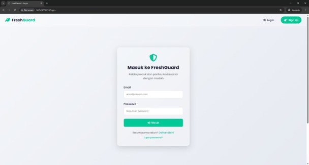
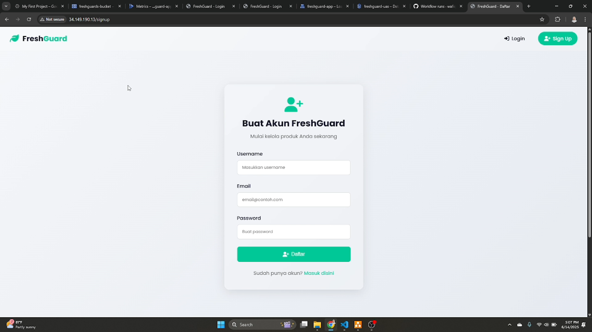
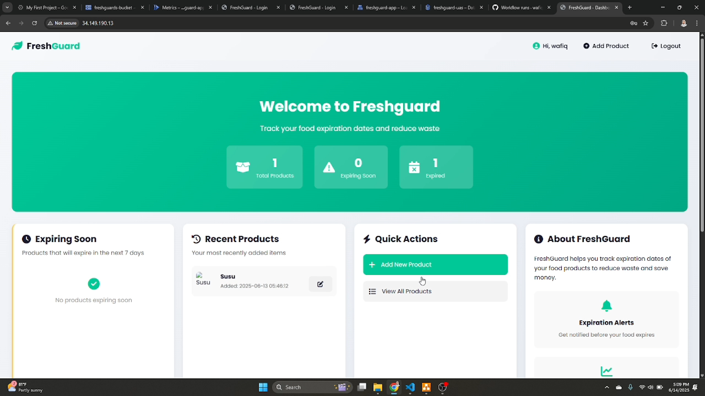
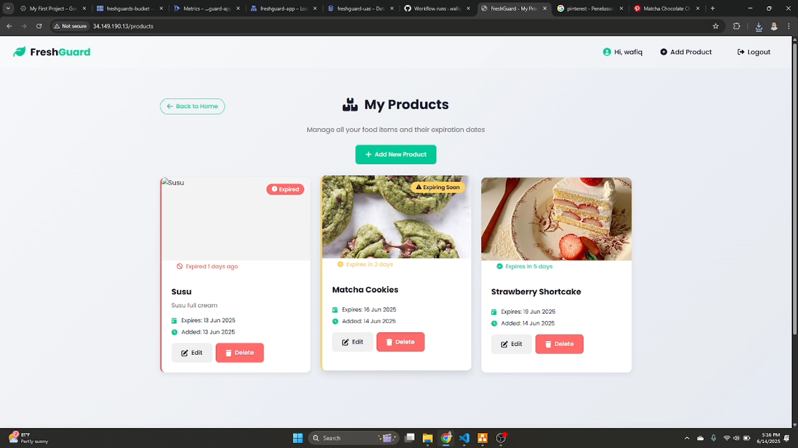
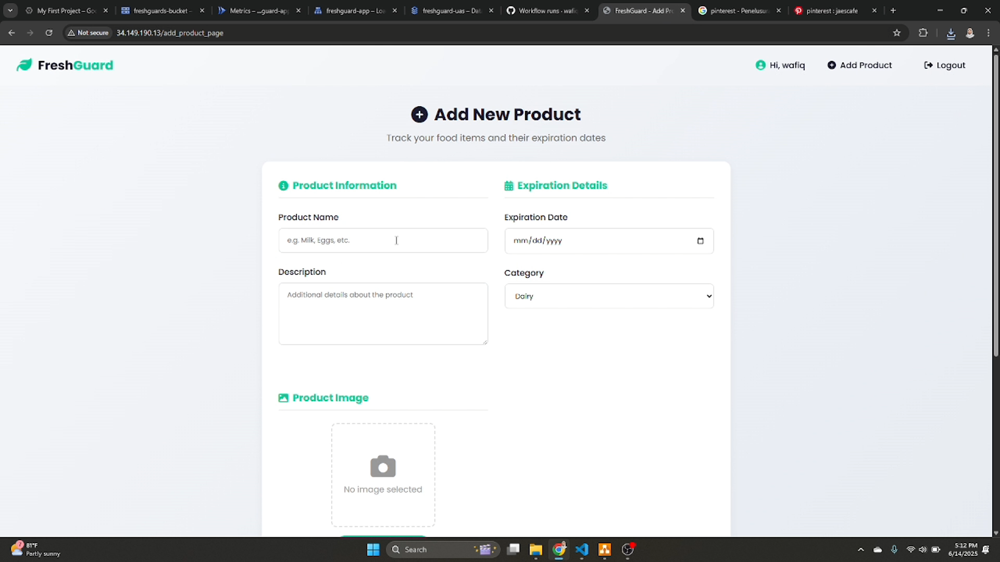
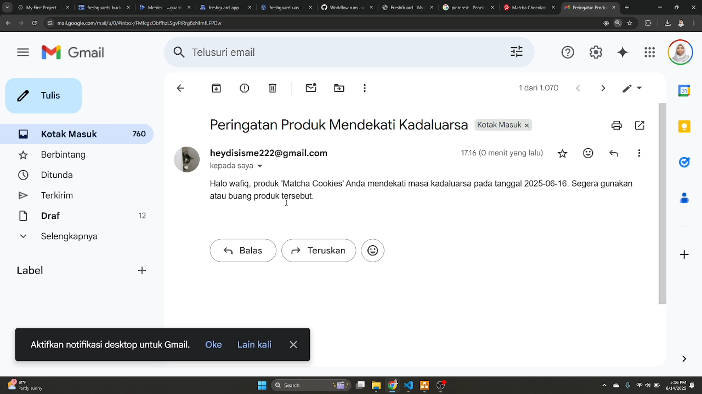
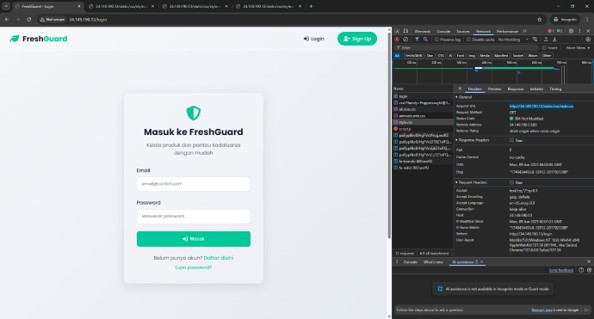
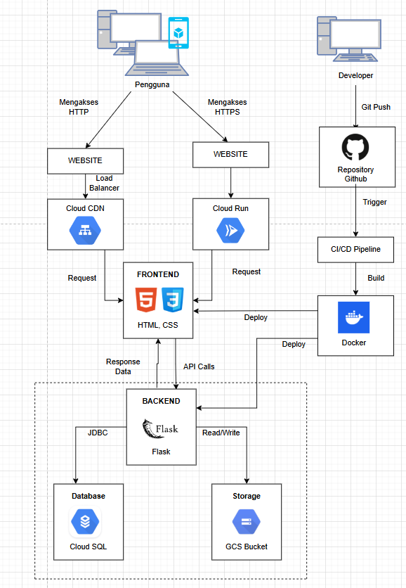

# FreshGuard

**Food expiry tracker, built with Flask and deployed on Google Cloud.**

FreshGuard helps people keep track of the expiry dates of the food and products they store at home. Users add their items, see at a glance what is safe, expiring soon, or already expired, and get an email reminder before something goes bad.

Built as the final project for *IFB-452 Cloud Computing* (Informatics, Institut Teknologi Nasional Bandung, 2025). The goal was to take a small web app all the way from localhost to a containerized, automatically deployed cloud service.

**Status:** The app was hosted on Google Cloud Run using a GCP free trial, which has since ended, so the live demo is offline. The demo video and screenshots below show it running.

**Demo video:** <!-- add your YouTube (unlisted) link here -->

---

## Screenshots

| Login | Register |
| --- | --- |
|  |  |

| Dashboard | Product list |
| --- | --- |
|  |  |

| Add product | Expiry email notification |
| --- | --- |
|  |  |

### Cloud deployment evidence

Cloud CDN cache hit (the `Age` response header shows the response was served from cache):



<!-- Optional, add when available:


-->

---

## Features

- **Register and login** with per-user accounts. Passwords are stored as hashes, not plain text.
- **Dashboard** that groups products into three categories: not expired, near expiry, and expired.
- **Product management:** add, edit, and delete products (name, expiry date, type, description, and an uploaded product image).
- **Email reminders** sent automatically when a product expires in 3 days or less. Each email goes only to the owner of that product.
- **Cloud-hosted data**, so the list is accessible from any device.
- **Responsive UI** for desktop and mobile.

---

## Architecture



**Deployment flow:** every push to `main` triggers a GitHub Actions workflow (`.github/workflows`) that authenticates to Google Cloud with a service account, builds the Docker image, pushes it, and deploys a new revision to Cloud Run.

---

## Tech Stack

| Layer | Technology |
| --- | --- |
| Frontend | HTML, CSS (Jinja2 templates) |
| Backend | Python, Flask |
| Database | MySQL (Cloud SQL) |
| Storage | Google Cloud Storage |
| Container | Docker |
| Hosting | Google Cloud Run |
| CDN | Google Cloud CDN (via external load balancer) |
| CI/CD | GitHub Actions |
| Access control | GCP IAM and service accounts |

---

## Project Structure

```
FreshGuard/
├── .github/workflows/   # CI/CD pipeline (build, push, deploy to Cloud Run)
├── static/              # CSS and static assets
├── templates/           # HTML templates
├── app.py               # Flask app and routes
├── config.py            # Database and app configuration
├── utils.py             # Expiry date logic and notification helpers
├── freshguard.sql       # Database schema
├── requirements.txt     # Python dependencies
└── Dockerfile
```

### Database schema

- `users`: `id`, `username`, `email`, `password`
- `products`: `id`, `user_id`, `product_name`, `description`, `expiry_date`, `image`, `notified`, `created_at`

---

## Deploy to Google Cloud (summary)

1. Create a Cloud SQL (MySQL) instance and import `freshguard.sql` (optionally through a Cloud Storage bucket).
2. Create a service account with the `Cloud SQL Client` role for the app, and another for GitHub Actions with roles to build, push, and deploy.
3. Store the GitHub Actions service-account key as a repository secret.
4. Push to `main`. The workflow builds the image and deploys it to Cloud Run, attached to the Cloud SQL instance.
5. Optional: put Cloud Run behind an external load balancer with Cloud CDN enabled to cache static content.

---

## What I Learned

- Containerizing a Flask app and adapting it to Cloud Run (port, environment, Cloud SQL connection).
- Setting up a CI/CD pipeline that deploys on every push.
- Managing access with IAM roles and service accounts using least-privilege roles.
- Connecting a managed database (Cloud SQL) and object storage to a serverless container.
- Serving content through Cloud CDN and verifying caching.

## Future Improvements

- Search and filter by date or product type
- Notifications through WhatsApp or Telegram
- Two-factor authentication
- Monitoring and alerting with Cloud Monitoring
- Infrastructure as Code (Terraform) for reproducible setup

---

## Team

- Wafiq Mariatul Azizah
- Raden Dika Natakusumah
- Rhestu Dzulkifli
